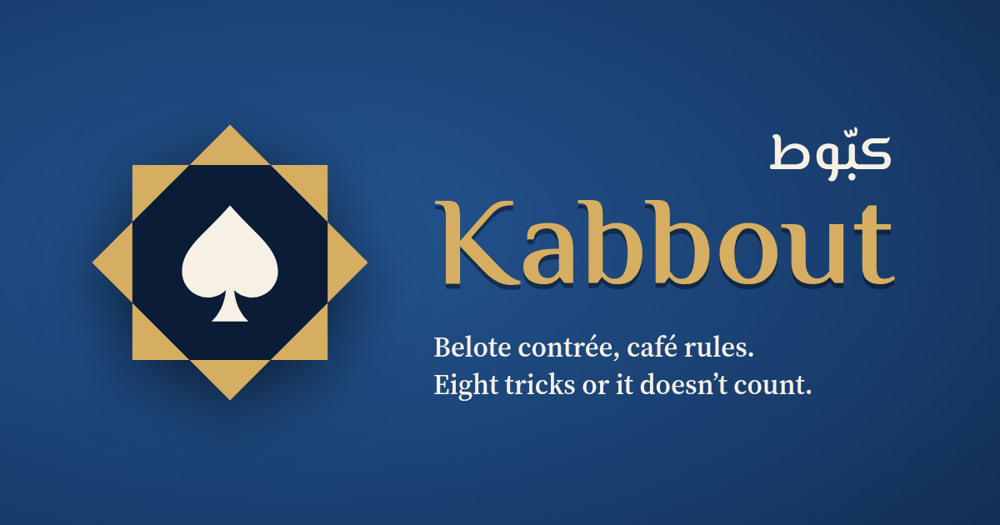

# Kabbout



[](https://github.com/falisco/kabbout/actions/workflows/ci.yml)

Belote contrée for four: you and your partner against two opponents, at a quiet table with no chips. In French, English and Tunisian Arabic, counted the federation's way or the Tunisian way. The goal is an iOS / Android app, playable alone against robots and online with friends.

**The name.** At a Tunisian café table nobody says _capot_ when a side takes all eight tricks. They say _kabbout_ (كبّوط), and they say it loud. The emblem is the eight-pointed star of the tilework: one point per trick. During a deal a star in the middle of the table lights one point for each trick, in the colour of the side that took it; eight points of one colour and the whole screen says Kabbout.

## Layout

| Folder     | Content                                                                                                                                                                                                                                                                                                                                                                                                                                                                                                                                                                 |
| ---------- | ----------------------------------------------------------------------------------------------------------------------------------------------------------------------------------------------------------------------------------------------------------------------------------------------------------------------------------------------------------------------------------------------------------------------------------------------------------------------------------------------------------------------------------------------------------------------- |
| `engine/`  | The game engine in TypeScript: rules, bidding, scoring, robots. A pure state machine (`apply(state, seat, action)`) with no DOM and no timers, usable in the app and on a server. Each player only receives a `PlayerView`, which does not hold the others' cards.                                                                                                                                                                                                                                                                                                      |
| `bridge/`  | The engine behind a small HTTP service, for the server side only: new game, action, view of a seat, legal moves, robot's move, replay of a recorded deal. It keeps nothing between two calls (the game travels in the request), draws from a seed sent by the caller, and has no dependency beyond Node. `contract/cases.json` records what it answers; both sides are tested against it.                                                                                                                                                                               |
| `server/`  | The server side, in PHP, cut by bounded context, then by layer. `Game/Domain` holds the `Engine` port and the words of the table (seat, suit, card, action, seed, game state, seat view, recorded deal) with its `Exception/`. `Game/Infrastructure/Bridge` holds `BridgeEngine`, the adapter that only says which call each question becomes, with `Transport/` (how a call travels) and `Mapping/` (how an answer is read into the domain). The rules are not written a second time in PHP, and a test (`tests/Architecture`) keeps the domain free of any framework. |
| `app/web/` | The game: `index.html` (layout), `styles.css`, `src/` (the interface in modules, see below), `test/` (tests of the game session and of the texts), `sounds.js` (CC0 sounds), `cards/`, `fonts/` (embedded: the page loads nothing from another site), `brand/` (app icons, share image). `npm run build:web` bundles `src/` and the engine into `app.js` (generated, not versioned).                                                                                                                                                                                    |
| `e2e/`     | Functional tests in a real browser (Playwright): games played through the interface (taking a contract, contre, advice, quick phrases, tutorial), keyboard, undo, the three languages, layout on five phone formats, sounds, accessibility audit of every screen and dialog (axe, WCAG 2.2 AA).                                                                                                                                                                                                                                                                         |
| `scripts/` | `serve.mjs` (local server with no dependency), `check-conformity.mjs` (the conformity checks of the CI) and `run-coverage.mjs` (what `npm run test:coverage` runs).                                                                                                                                                                                                                                                                                                                                                                                                     |
| `tools/`   | `frcards.py` builds the cards from the CC0 deck (French indices, and the English court cards); `brand.mjs` draws the icon, the app icons, the card back and the share image from the star of the game (see `CREDITS.md`).                                                                                                                                                                                                                                                                                                                                               |

## Languages

French, English and Tunisian Arabic (derja, in Arabic letters). The game follows the browser's language (English when it speaks none of them) and the player can switch in the menu or the settings; the choice is remembered. `?lang=fr`, `?lang=en` or `?lang=ar` in the address forces one.

- Texts live in `app/web/src/i18n/` (`fr.js`, `en.js`, `ar.js`, same keys; `test/i18n.test.js` keeps them in step).
- In Arabic the texts read right to left (dialogs, bidding panel, messages); the table, the hand and the direction of play do not move, numbers stay 0-9 and a bid keeps its order (`90 ♥`).
- The three regulars are named in each language: Tonton Salah and Tata Mongia, Uncle Salah and Auntie Mongia, عم صالح and خالتي منجية.
- The words of the game stay as the table says them in both languages: belote, rebelote, contre, surcontre, kabbout.
- Court cards carry the index letters of the language: V D R in French and in Arabic, J Q K in English (`cards/en/`).
- The robots give their bidding reasons in the language of the screen (`engine/src/ai/phrases.ts`). A reason is written when the bid is made, so those already shown keep their language until the next deal.

## Rules

Those of the [official rules of belote contrée](https://www.ffbelote.org/wp-content/uploads/2016/01/regles-officielles-de-la-Belote-Contree-27-01-2016.pdf) of the Fédération Française de Belote (version of 27.01.2016), counting "points made + points bid", without the No Trump / All Trump variant.

- 32 cards shuffled at each deal and dealt 3-2-3; bids from 80 to 160 by tens, then the capot (shown as Kabbout), which nothing beats.
- Contre (×2) at one's turn to speak: the contract is fixed, only the side that was contred answers, by passing or with a surcontre (×4).
- Card play: follow suit, play a higher trump, ruff and overruff; no obligation to underruff; free choice when the partner is winning.
- Belote-rebelote 20 points, no other declarations, ten for the last trick; all eight tricks are worth 252.
- The contract is made as soon as the bidder reaches its value (tricks + belote), even if the defence scores more.
- Made: points made + contract, the defence keeps its points. Failed: 160 + contract to the defence, belote included whoever held it.
- Contre: 320 + contract × 2; surcontre: 640 + contract × 4; the belote goes to the winner of the deal, nothing to the other side (table of article 10.2, without the variant of note 1).
- Capot bid: 500, made or failed (× 2, × 4).
- Points rounded to the nearest ten; game to 1000 points, a tie beyond that is settled by one more deal.

These rules are pinned article by article in `engine/test/ffb-contree.test.ts`: any change to the engine that departs from them fails that file.

### Counting without contract (Tunisian)

The menu offers a second way of counting, the one of Tunisian cafés, where **the value bid is never added**: it only decides which side scores. A game keeps the count it started with; the choice is remembered for the next ones. The default is the federation's count above.

| Deal                                | Bidding side               | Defence                    |
| ----------------------------------- | -------------------------- | -------------------------- |
| Made                                | points made (+ its belote) | points made (+ its belote) |
| Made with all eight tricks, not bid | 250 (+ its belote)         | 0                          |
| Failed                              | 0                          | 160 + the belote           |
| Failed, the defence takes all eight | 0                          | 250 + the belote           |
| Contre / surcontre, made            | 320 / 640 + the belote     | 0                          |
| Contre / surcontre, failed          | 0                          | 320 / 640 + the belote     |
| Kabbout bid, made                   | 500 (× 2, × 4)             | 0                          |
| Kabbout bid, failed                 | 0                          | 500 (× 2, × 4)             |

Whether a contract is made is the same question in both counts. In the engine it is one field of the game (`scoring: 'ffb' | 'tunisian'`, set by `newGame`, `'ffb'` by default) and one table per count in `engine/src/scoring.ts`; `engine/test/tunisian-scoring.test.ts` pins this table. The expert robot plays its cards for the count in use; the robots' bidding is the same in both, calibrated on the federation's count (`npm run bench:robots -- --scoring tunisian` measures them).

## Interface (`app/web/src/`)

The screen never touches the engine directly: it goes through a **session**, which gives it the player's view (`PlayerView`), receives its actions and sends back the public events. Today's session runs the engine and the three robots in the page; an online session will offer the same from a server, without changing the rest.

| Module                                        | Role                                                                                                                                                                                                          |
| --------------------------------------------- | ------------------------------------------------------------------------------------------------------------------------------------------------------------------------------------------------------------- |
| `session.js`                                  | The game as one seat lives it: view, legal moves, actions, robots, advice, undo. No DOM, tested.                                                                                                              |
| `game.js`                                     | This screen's game (`session`, current `view`) and the questions asked of it: my turn? forced card?                                                                                                           |
| `selectors.js`                                | Questions answered from a view alone (bids still possible, may I contre, which trick may be looked at). No state, tested.                                                                                     |
| `flow.js`                                     | How it unfolds: pace of the robots and of the pauses, the kabbout screen, undo, advice.                                                                                                                       |
| `feedback.js`                                 | What the table shows and sounds like for each event of the game.                                                                                                                                              |
| `speech.js`                                   | The bubbles the players speak in.                                                                                                                                                                             |
| `render/`                                     | The drawing, which reads the state and never changes it: `table.js` (score, seats, hand, trick, star of the tricks), `bidding.js` (auction), `modals.js` (dialogs), `transient.js` (messages, announcements). |
| `input.js`                                    | Clicks, taps and keys, turned into actions.                                                                                                                                                                   |
| `store.js`, `storage.js`                      | Presentation state and settings, in small groups by purpose; reading and writing local storage.                                                                                                               |
| `audio.js`                                    | Recorded card noises, synthesised chimes (your turn, trick, end of deal and of game, refused card), background music.                                                                                         |
| `i18n/`                                       | The language of the screen and every text, in French, English and Tunisian Arabic.                                                                                                                            |
| `star.js`                                     | The eight-pointed star: the logo, the tricks of the deal, the kabbout screen.                                                                                                                                 |
| `config.js`, `labels.js`, `html.js`, `dom.js` | Seats, the three regulars and the pace; names and markup of cards and bids; escaping; reaching the page.                                                                                                      |

## Robots

`engine/src/ai/`. A robot only receives its `PlayerView`: it never sees the others' cards. At the table they are three regulars of the café: Selim, your partner, against Uncle Salah and Auntie Mongia (Tonton Salah and Tata Mongia in French, عم صالح and خالتي منجية in Tunisian Arabic).

- **Bidding** (`bidding.ts`), the same at every level so that the partner can rely on it: opening at 80 on a trump base (jack-nine third, or jack fourth), even with no top card beside it, +10 per ace, per long trump, +20 for the belote; one raise of the partner's suit; capot only when it is certain. The contre is rare and calibrated on tens of thousands of deals: nine of trumps fourth, or third with two aces. The surcontre needs a margin of 30 points over the two hands.
- **Memory** (`memory.ts`): the cards played and what they reveal (a suit not followed, a trump not raised or not overruffed, the second card of a belote).
- **Card play**, three levels, set in the menu and the settings:

| Level    | What it does                                                                                                                                                      |
| -------- | ----------------------------------------------------------------------------------------------------------------------------------------------------------------- |
| `easy`   | Plays by rules of thumb (`policy.ts`) and forgets the tricks already played.                                                                                      |
| `normal` | Same rules, with the memory: stops drawing trumps when the opponents have none left, does not give an ace to a ruff, feeds its partner when the trick is safe.    |
| `expert` | Imagines 50 layouts of the hidden cards consistent with what it has seen and with the bidding, plays each possible card to the end and keeps the best on average. |

`npm run bench:robots` measures them in duplicate games (each deal played twice, sides swapped): normal takes about 10 points a deal from easy, expert more than 30 from normal. In the app the expert thinks for at most 0.12 s per card: on a slow device it imagines fewer layouts (12 at least). `engine/test/robots-strength.test.ts` keeps that order.

## Contract between the engine and its clients

The engine is made to run on a server too, facing clients it does not take at their word. `engine/test/contract.test.ts` keeps these guarantees:

- **What a player receives**: `viewFor(state, seat)` and `publicEvents(events)` hold neither the others' cards, nor a belote not yet announced, nor the robots' reasoning (which describes their cards and stays in the full state).
- **What the engine accepts**: `apply(state, seat, action, rng)` refuses with an `EngineError` any unknown seat, any action that is malformed, out of turn or against the rules, and only copies the known fields of an action into the state.
- **No saved game**: a game lives as long as the page. Only the settings, the language, the robots' level and the statistics are stored on the device.

## Bridge between the engine and the server

The rules stay in TypeScript, shared by the game in the browser and the server: a PHP copy would be a second rule book to keep in step. The server asks them through `bridge/`, which answers JSON over HTTP on the internal network only, since it hands out full game states.

| Call                 | Answer                                                                                                                 |
| -------------------- | ---------------------------------------------------------------------------------------------------------------------- |
| `POST /games`        | A new game dealt from `seed` (32 to 64 hexadecimal digits; `scoring`, `target` and `dealer` as the engine takes them). |
| `POST /games/apply`  | The game after one `action` of one `seat`, and the public events.                                                      |
| `POST /games/view`   | What one seat may know: its hand and everything public.                                                                |
| `POST /games/legal`  | The bids and cards open to a seat now; nothing out of turn.                                                            |
| `POST /games/robot`  | What a robot of a given `level` does for the seat to act, from that seat's view alone.                                 |
| `POST /deals/replay` | A recorded deal (count, dealer, auction, eight tricks) played again: hands, contract, tricks, score sheet.             |
| `GET /health`        | `{ "ok": true }`                                                                                                       |

- What the engine refuses, the bridge refuses: `422` with the engine's own message, and for a recorded deal the bid or the trick and seat where it goes wrong. A request it does not understand is a `400`.
- A seat's view never holds another hand, a belote not yet announced or a robot's reasoning; `bridge/test/bridge.test.ts` checks every view of a whole game.
- Every call that draws at random takes a seed, so the same question always gets the same answer, byte for byte. A seed is 128 to 256 bits and the draws are an HMAC-SHA256 stream: the engine's own generator takes 32 bits, few enough to try them all against the eight cards of a hand and find the three others. A view gives the hand sorted, not in the order it was dealt.
- A seed serves one call. On the PHP side a game keeps one secret `Seed` and derives a new one for each call (`$secret->derive('move 17')`); a seed used twice deals the same cards twice.
- On the PHP side, `Engine` is the only door. The full state, a robot's move with its reason and a step only come out through methods named `toEngineArray()`; what may be sent to a player is a `SeatView`, or `toPublicArray()`. A recorded deal sent by a client is checked for its shape and stripped to its known fields by `DealRecord::fromArray()` before the engine judges it.
- `bridge/contract/cases.json` is recorded from the bridge (`npm run contract:record`) and checked against it by its tests; the PHP tests then make the same calls through `BridgeEngine`, against the running bridge and against a transport that replays the recording (`tests/Support`).

## Commands

Node 22.18+ (TypeScript run natively, no compilation).

```bash
npm install                 # development tools
npm run serve               # builds app.js and serves the game on http://127.0.0.1:4173
npm test                    # engine (FFB rules, contract, non-regression on 33 games replayed card for card), bridge, game session, texts
npm run test:e2e            # functional browser tests (installed Chrome locally, Chromium in CI)
npm run test:coverage       # unit and browser tests together; fails under 80% of lines or branches run (report in coverage/)
npm run lint                # ESLint: shadowed names, unused code, functions over 60 lines
npm run check               # everything: types, format, lint, conformity, unit, browser, coverage
npm run bridge              # starts the bridge on http://127.0.0.1:8787 (BRIDGE_HOST, BRIDGE_PORT)
npm run check:php           # PHP side: coding standard, PHPStan at its strictest, PHPUnit against a running bridge; fails under 80% of lines run (PHP 8.5 with pcov, or Docker)
npm run contract:record     # after an intended change of the bridge: records bridge/contract/cases.json again
npm run bench:robots        # measures the robots' levels against each other (add `-- --scoring tunisian` for the other count)
npm run test:golden:update  # after an intended change of rules or robots: records the reference games again
node tools/brand.mjs        # after a change of the emblem: draws the icons, the card back and the share image again
```

URL parameters for tests: `?seed=42` makes the deal and the robots' choices reproducible, `?fast` makes the robots instant, `?lang=en` sets the language.

## Continuous integration

`.github/workflows/ci.yml`, on every push to `main` or `develop` and every pull request:

1. **Quality**: type checking, format (Prettier), lint (ESLint), conformity (expected cards, CC0 and font credits, nothing loaded from another site, a Content-Security-Policy and no inline script or style, no `eval`, no third-party brand name, no secret in the repository), `npm audit` at moderate level.
2. **Unit and non-regression tests**: rules, scoring, bidding, robots, 160 simulated games, 33 reference games replayed card for card (both counts, the three robot levels), the three dictionaries, settings and storage, the screen's questions about a game.
3. **PHP side**: coding standard (php-cs-fixer, Symfony rules), static analysis (PHPStan at its strictest), `composer audit`, and the PHPUnit tests with the bridge running; fails under 80% of the lines of `server/src` run.
4. **Browser tests and coverage** (after the first two): Chromium, desktop and one phone (375 wide) for every test, four more phone formats for the layout (portrait 360 and 320 wide, landscape 812 and 667), and WebKit as an iPhone 13 (Safari's engine) for the layout, the sounds and whole games; fails under 80% of lines or branches run by unit and browser tests together; coverage report attached, Playwright report and traces on failure.

## Branches

Git flow. `main` only holds released versions, each one tagged; `develop` is where finished work meets. A piece of work lives on `feature/<nn>-<name>`, cut from `develop` and merged back with a merge commit once `npm run check` is green. A version is prepared on `release/<x.y.z>`, then merged into `main` (tagged `v<x.y.z>`) and back into `develop`; an urgent fix to a released version goes through `hotfix/<x.y.z>` the same way.

## Roadmap

1. ~~Extract the engine with tests~~
2. ~~Plug `app/web` into `engine/` and remove the copy of the rules~~
3. ~~French, English and Tunisian Arabic, the Tunisian count, and a name: Kabbout~~
4. Mobile app with Capacitor (solo, offline) + AdMob advertising, GDPR / ATT consent
5. Online server (private tables by code, replacement robots, reconnection)
